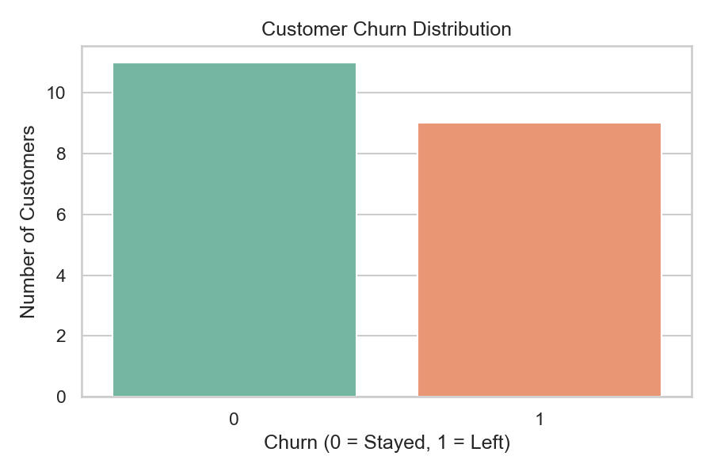
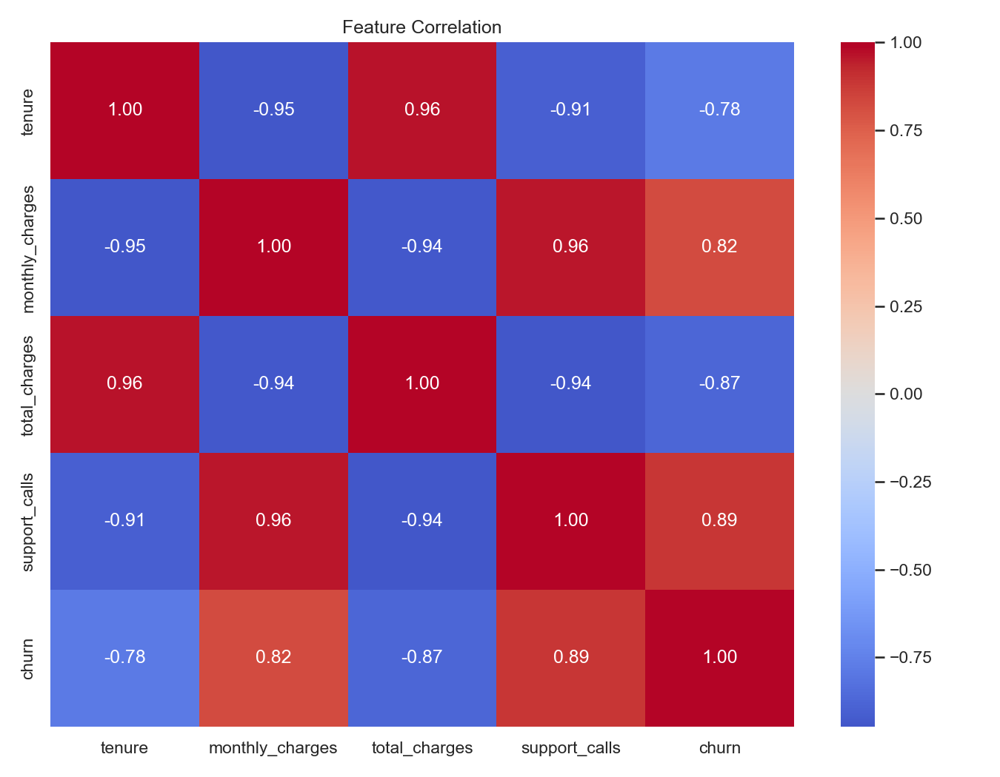

# Customer Churn Prediction System

A practical machine learning project that predicts whether a telecom customer
is likely to stop using the company's services.

## Project objective

Build an end-to-end classification workflow that demonstrates how to:

- Load and inspect customer data.
- Clean missing values and remove duplicates.
- Explore factors associated with churn.
- Train and compare classification models.
- Evaluate model performance with classification metrics.
- Save a trained model and generate a churn prediction for a customer.

## Business problem

Customer churn reduces recurring revenue and increases the cost of acquiring
replacements. A telecom company wants to identify customers who are likely to
leave so that retention teams can prioritize outreach and offer appropriate
support.

This project produces two outputs for that use case:

1. A churn probability for an individual customer.
2. A binary prediction indicating whether the customer is likely to churn.

## Dataset

The project uses a small synthetic dataset: `data/customers.csv`.

| Column | Description |
| --- | --- |
| `customer_id` | Unique customer identifier (not used as a model feature) |
| `tenure` | Months the customer has been with the company |
| `monthly_charges` | Current monthly bill |
| `total_charges` | Total amount charged to date |
| `support_calls` | Number of support calls made |
| `churn` | Target: `1` if the customer left, `0` if they stayed |

The dataset contains 20 records and 9 churned customers. It is intentionally
small and synthetic: it is designed for learning the project workflow, not for
building a reliable business prediction model.

## Technologies used

- Python 3.10
- pandas and NumPy for data handling
- Matplotlib and Seaborn for visualization
- scikit-learn for preprocessing, modeling, and evaluation
- joblib for model persistence

## Project structure

```text
Customer churn prediction system/
│
├── data/
│   └── customers.csv
│
├── models/
│   ├── churn_model.pkl
│   └── model_metadata.json
│
├── reports/
│   ├── churn_distribution.png
│   ├── correlation_heatmap.png
│   └── model_comparison.csv
│
├── main.py
├── train.py
├── predict.py
├── requirements.txt
├── .gitignore
└── README.md
```

## Data preprocessing

`main.py` and `train.py` apply the same basic preprocessing steps:

1. Remove duplicate rows.
2. Identify numerical columns.
3. Fill missing numerical values with the column median.
4. Exclude `customer_id` from the model features.
5. Split the data into 75% training and 25% testing sets using stratification
   to preserve the churn class balance.

The modeling pipelines also include preprocessing so the saved model can accept
raw customer values directly:

- Median imputation for missing values.
- Standard scaling for Logistic Regression.
- Median imputation only for Random Forest.

## Exploratory data analysis

`main.py` reports churn counts, group averages, and correlations, and saves two
charts in `reports/`.





Observations from this synthetic dataset:

- Churned customers have much shorter tenure on average: **4.6 months** versus
  **33.7 months** for retained customers.
- Churned customers make more support calls on average: **5.1** versus **1.1**.
- Churned customers have higher average monthly charges: **$85.44** versus
  **$52.55**.
- `support_calls` has the strongest positive correlation with churn, while
  `tenure` and `total_charges` have strong negative correlations.

These relationships are specific to this small synthetic sample and should not
be treated as general telecom industry conclusions.

## Algorithms used

Two classification pipelines are compared:

### Logistic Regression

A linear baseline that estimates churn probability from the input features. It
is easy to interpret and works well when relationships are approximately
linear. Standard scaling is applied before fitting.

### Random Forest

An ensemble of decision trees that can learn nonlinear relationships and
feature interactions. Class balancing is used to account for the uneven target
distribution, and tree depth is limited to reduce overfitting on the small
dataset.

The model with the best holdout F1 score is saved as
`models/churn_model.pkl`. The selection metric is F1 because correctly finding
likely churners matters more than raw accuracy alone.

## Evaluation metrics

The project reports:

- **Accuracy** — share of all predictions that are correct.
- **Precision** — share of predicted churners who actually churned.
- **Recall** — share of actual churners that the model identified.
- **F1 score** — harmonic mean of precision and recall.
- **ROC AUC** — ability to rank churners above non-churners across thresholds.
- **Confusion matrix** — counts of true positives, true negatives, false
  positives, and false negatives.

Current holdout results (5 test records):

| Model | Accuracy | Precision | Recall | F1 | ROC AUC |
| --- | ---: | ---: | ---: | ---: | ---: |
| Logistic Regression | 0.800 | 0.667 | 1.000 | 0.800 | 1.000 |
| Random Forest | 1.000 | 1.000 | 1.000 | 1.000 | 1.000 |

Random Forest was selected and saved. The perfect score is a warning sign, not
proof of production quality: only five records were used for testing, and the
synthetic data has very clear separation between churn groups.

## How to run the project

### 1. Create and activate a virtual environment

Windows Command Prompt:

```bat
python -m venv venv
venv\Scripts\activate
```

Windows PowerShell:

```powershell
python -m venv venv
.\venv\Scripts\Activate.ps1
```

macOS/Linux:

```bash
python3 -m venv venv
source venv/bin/activate
```

### 2. Install dependencies

```bash
pip install -r requirements.txt
```

### 3. Inspect the data and generate EDA charts

```bash
python main.py
```

Charts and summaries are written to `reports/`.

### 4. Train and evaluate the models

```bash
python train.py
```

This trains both pipelines, prints evaluation metrics, compares their holdout
performance, and saves the best model plus metadata.

### 5. Make a prediction

Run the built-in example:

```bash
python predict.py
```

Or provide customer details:

```bash
python predict.py --tenure 5 --monthly-charges 90 --total-charges 450 --support-calls 5
```

Example output:

```text
Customer profile:
 tenure  monthly_charges  total_charges  support_calls
      5               90            450              5

Customer is predicted to churn.
Churn probability: 99.74%
```

The probability is the model's estimated likelihood based on patterns in the
training data. It is not a guarantee that a particular customer will leave.

## Limitations

- **Very small sample:** 20 records are far too few to train or validate a
  reliable production model.
- **Synthetic data:** the data is constructed for learning and does not reflect
  the complexity of real customer behavior.
- **Unstable evaluation:** a single 5-record test split can change dramatically
  with a different random seed or a few different customers.
- **Limited features:** real churn depends on contract type, service usage,
  payment history, satisfaction, competitor offers, and other factors not
  represented here.
- **No temporal validation:** a production system should be tested on future
  customers to measure how well predictions hold up over time.
- **No probability calibration:** predicted probabilities have not been
  calibrated against real outcomes.
- **Potential proxy relationships:** `total_charges` is related to tenure and
  monthly charges, so feature importance should be interpreted carefully.

## Next steps for a production version

1. Collect a larger, representative, time-based telecom dataset.
2. Add contract, payment, service, and customer-satisfaction features.
3. Use cross-validation and time-based validation instead of one small split.
4. Tune models and calibrate predicted probabilities.
5. Select a decision threshold based on retention-campaign costs and benefits.
6. Monitor data drift, model performance, and fairness after deployment.
7. Add automated tests, logging, and a repeatable training pipeline.

## Author

Built as a portfolio-style machine learning project.
